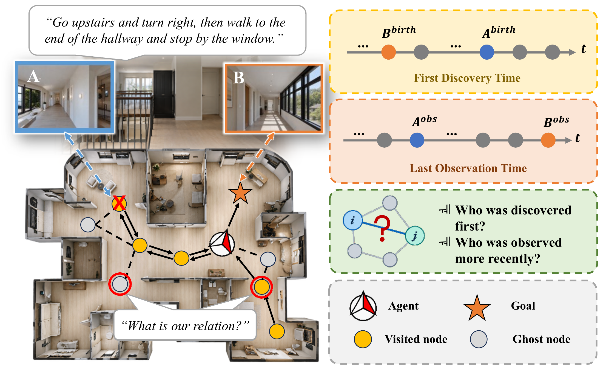
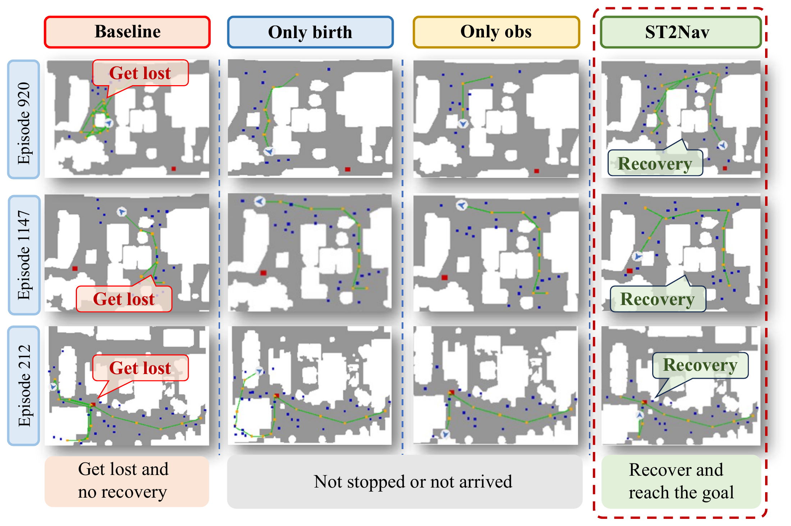
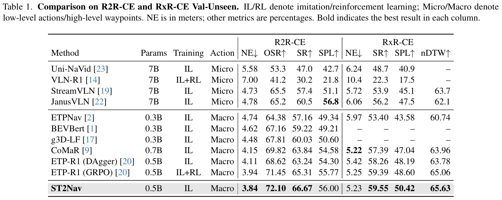
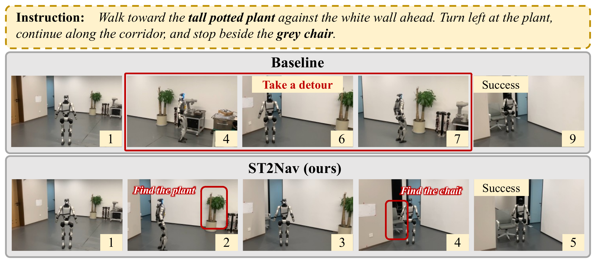

# ST2Nav

Online topological maps enable long-range planning for vision-and-language navigation in continuous environments, yet spatial relations alone cannot fully describe exploration history. Node discovery and last-observation times offer complementary cues for reasoning over explored locations and candidate frontiers. We propose **ST2Nav**, a spatio-temporal relation learning framework that explicitly incorporates these cues into topological planning. During training, **Masked Temporal Relation Recovery (MTR)** predicts discretized discovery-time and last-observation-time differences for masked node pairs. The predicted distributions form differentiable soft relation embeddings that feed into **Spatio-Temporal Graph-Aware Self-Attention (ST-GASA)**, combining temporal relations with shortest-path spatial biases. This coupling allows navigation supervision to directly guide temporal relation learning through the planning process. At inference, ST2Nav uses recorded temporal relations without running the recovery heads. Experiments on R2R-CE and RxR-CE demonstrate consistent improvements over the imitation-learning backbone, while real-world robotic experiments further demonstrate the framework's effectiveness.

<p align="center">
  
</p>

## Repository layout

```text
ST2Nav/
├── README.md
├── assets/          # Overview, simulation, results and deployment figures
├── simulation/      # Only files changed or added relative to ETP-R1
└── deployment/      # Robot client and standalone GPU inference server
    ├── robot/
    └── server/
        ├── runtime/
        ├── vendor/  # Required inference code, tokenizer and third-party notices
        └── weights/ # Checkpoint configuration and checksums
```

`simulation/` contains the code and configuration to merge into ETP-R1. `deployment/` contains the robot client and GPU inference server.

## Installation and data preparation

Follow the instructions in the [ETP-R1 repository](https://github.com/Cepillar/ETP-R1.git) to set up the environment, datasets and pretrained assets, then apply this project's source overlay as described below. ST2Nav uses the same pretrained weights as ETP-R1 to initialize the navigation model.

## Apply the source overlay

Copy all contents of `simulation/` into the ETP-R1 root, merging `habitat_extensions/`, `run_r2r/`, `run_rxr/`, and `vlnce_baselines/` into the same-named baseline folders and overwriting matching files. Keep baseline files that are absent from this lightweight overlay; do not delete the destination folders first.

Use a separate ETP-R1 working copy for each project. From this repository's root, with `ETP-R1/` alongside it:

```bash
cp -a ../ETP-R1 ../ETP-R1-ST2Nav
cp -a simulation/. ../ETP-R1-ST2Nav/
cd ../ETP-R1-ST2Nav
conda activate etpr1
```

## Training and evaluation

Run commands from the overlaid ETP-R1 working directory. The launchers use **one GPU** with eight R2R or six RxR environments for training/evaluation. Use `main.bash` below; the baseline's `main_server.bash` is not the ST2Nav launcher.

Before running, edit `run_r2r/iter_train.yaml` or `run_rxr/iter_train.yaml`:

- Set `MODEL.pretrained_path` to the local ETP-R1 pretrained checkpoint, e.g. `pretrained/r2r_rxr_ce/mlm.sap_habitat_depth/store2/model_step_367500.pt`.
- `IL.load_from_ckpt` defaults to `False`. To continue from online weights, set it to `True` and set `IL.ckpt_to_load`.
- Set `EVAL.CKPT_PATH_DIR` to the checkpoint to evaluate, or pass it as the third `eval` argument. For test inference, set `INFERENCE.CKPT_PATH` and `INFERENCE.PREDICTIONS_FILE` before running `inference`.

```bash
# R2R online SFT and evaluation
CUDA_VISIBLE_DEVICES=0 bash run_r2r/main.bash train 2333
CUDA_VISIBLE_DEVICES=0 bash run_r2r/main.bash eval 2333 /path/to/st2nav-r2r.pth

# RxR online SFT and evaluation
CUDA_VISIBLE_DEVICES=0 bash run_rxr/main.bash train 2334
CUDA_VISIBLE_DEVICES=0 bash run_rxr/main.bash eval 2334 /path/to/st2nav-rxr.pth

# Optional test predictions, after configuring INFERENCE paths
CUDA_VISIBLE_DEVICES=0 bash run_rxr/main.bash inference 2334
```

`EXP_NAME` controls the output directory under `data/logs/checkpoints/`. Evaluation results go into its `eval_results/` subdirectory. The experiment names are `release_r2r_stgasa_mtr` and `release_rxr_stgasa_mtr`.

## Simulation examples and results

<p align="center">
  
  
</p>

## Real-world deployment

The additional `deployment/` pipeline connects a **Unitree G1** with two fixed **Intel RealSense D435i** RGBD cameras to a separate NVIDIA GPU server:

1. The robot collects 24 RGBD frames: two cameras at 12 headings, 30° apart, with calibrated poses.
2. The server reconstructs a panorama and 12 virtual 90° views, runs waypoint prediction and the ST2Nav policy, and returns a planned route or STOP.
3. The robot executes route segments and sends execution feedback for graph updates. Experiment records are stored outside the repository.

<p align="center">
  
</p>

Deployment uses its own **Python 3.10** environment and requirements, separate from the legacy Habitat simulation environment. Inference requires a compatible ST2Nav checkpoint and the baseline waypoint predictor. Configure their paths and SHA-256 checksums as described in [checkpoint setup](deployment/server/weights/README.md) before starting the server or running replay.

Follow [deployment setup](deployment/README.md) for dependencies, SDK installation, private connection settings, calibration and authentication. After completing that setup:

```bash
# GPU server (from this repository root)
cd deployment/server
python tests/check_package.py
python tests/check_storage.py
python server.py --host YOUR_BIND_HOST --port 18766 --model st2nav
```

On the configured robot, from `deployment/robot/`, run `./run.sh check` before following the supervised navigation procedure in the deployment guide. Camera calibration, motion authorization and the stop controls are documented there.

Saved model inputs can be replayed on the server without commanding motion:

```bash
python replay.py --input /path/to/model-input.npz \
  --instruction "Go forward." --output /path/to/result.json
```

Default records are written to `~/navigation_results/st2nav/`, with separate `robot/` and `server/` subdirectories on their respective computers. `NAV_RESULTS_DIR` or `--results-dir` overrides this location.

## Acknowledgements

We thank [ETPNav](https://github.com/MarSaKi/ETPNav), [g3D-LF](https://github.com/MrZihan/g3D-LF), [CoMaR](https://github.com/VIPL-EPP/CoMaR), and [ETP-R1](https://github.com/Cepillar/ETP-R1) for sharing their works.
